# GOVIA Cameroun

*[English version](README.md)*

Agent d'assistance aux démarches administratives et de contrôle de conformité, bilingue FR/EN. Développé pour le hackathon ITU AI for Good Lab.

GOVIA couvre les pièces d'identité et l'état civil, mais aussi l'entreprise, les impôts, la protection sociale, l'urbanisme, le foncier, le commerce extérieur, les véhicules et les associations. Il cite ses sources, demande une précision plutôt que de deviner et dit clairement quand aucun texte ouvert n'existe.

## Captures d'écran

**Annuaire des démarches** : 43 démarches, chacune marquée couverte par un texte ouvert, partielle ou sans texte ouvert.

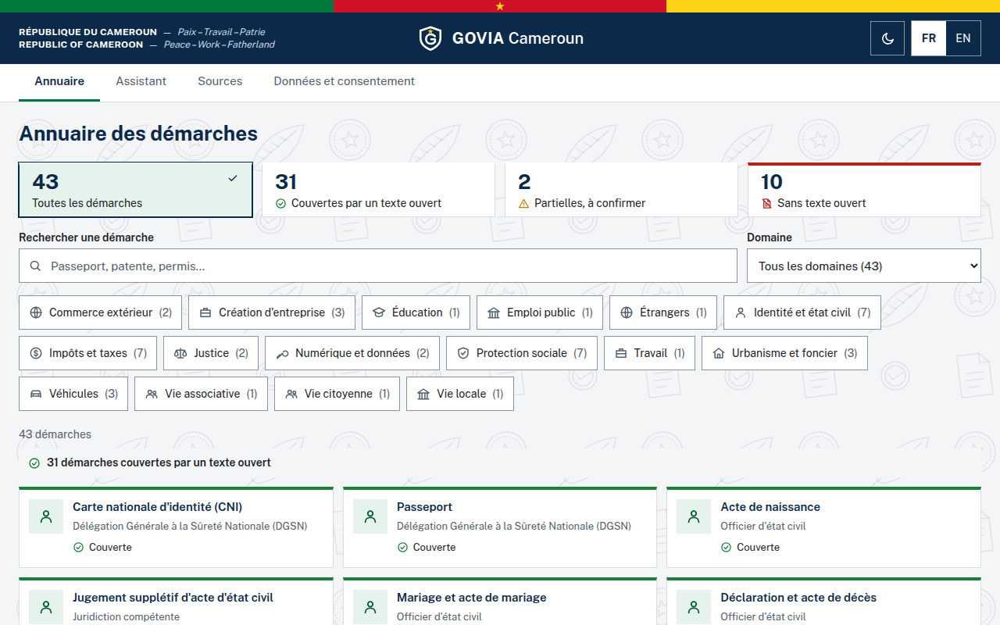

**Précision requise** : « Je veux renouveler ma carte » peut viser trois démarches. GOVIA demande au lieu de deviner, et explique pourquoi.

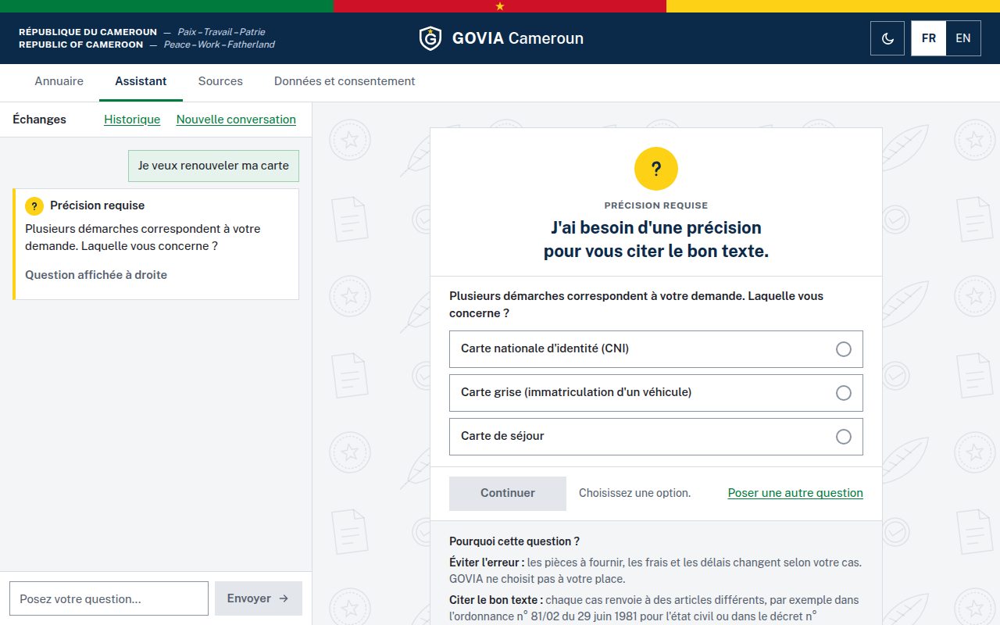

**Réponse sourcée** : CNI perdue. Chaque affirmation renvoie à son article ou à son étape, et la fiche signale qu'une source reste « à vérifier ».

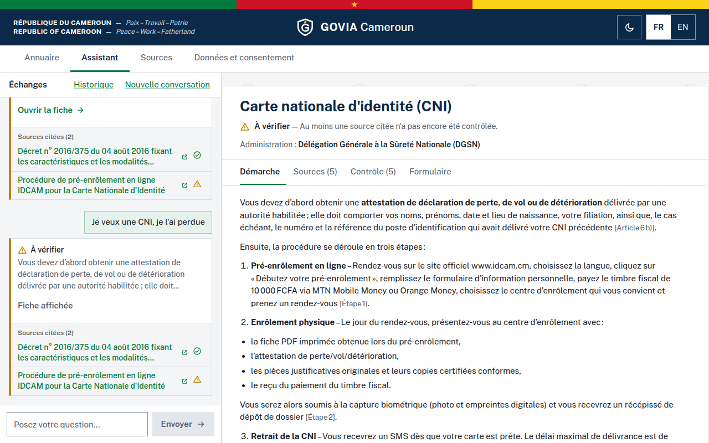

**Contrôles de l'auditeur** : verdict, décision de publication et résultat de chaque contrôle, visibles par le citoyen.

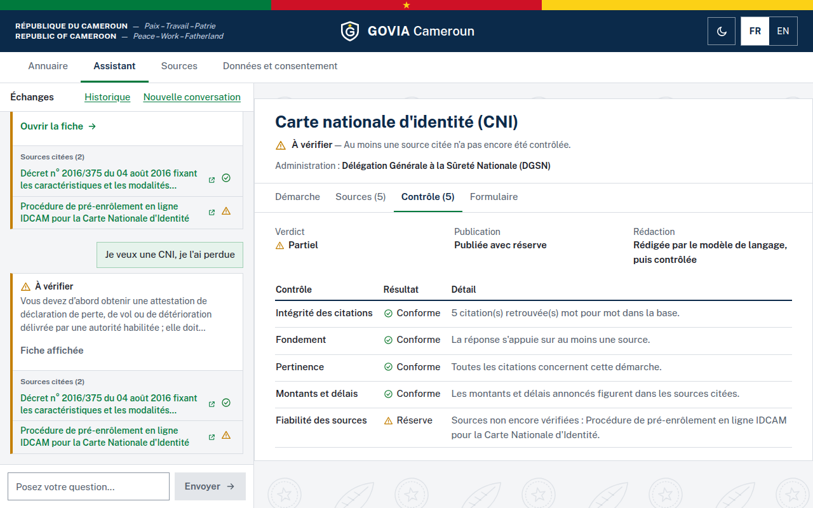

**Lacune déclarée** : aucun texte ouvert n'encadre le permis de conduire ; GOVIA le dit et n'invente aucune étape.

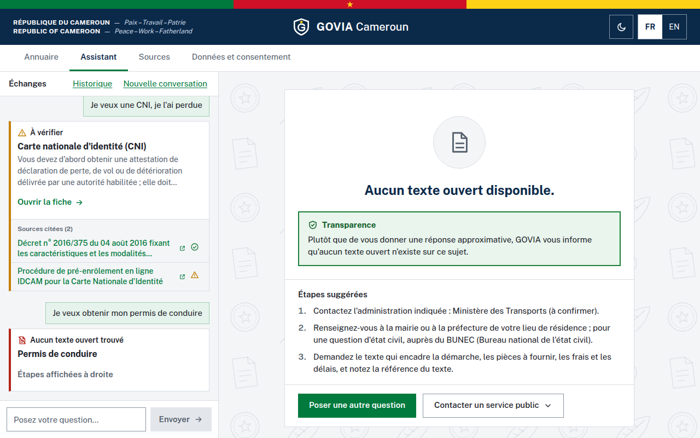

### Sur téléphone

Sur téléphone, une réponse s'ouvre en plein écran avec un lien « Retour aux échanges », et les contrôles s'empilent.

<table>
  <tr>
    <td align="center">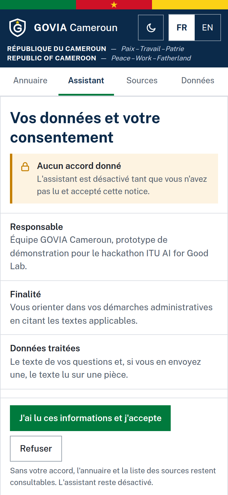<br>Consentement d'abord</td>
    <td align="center">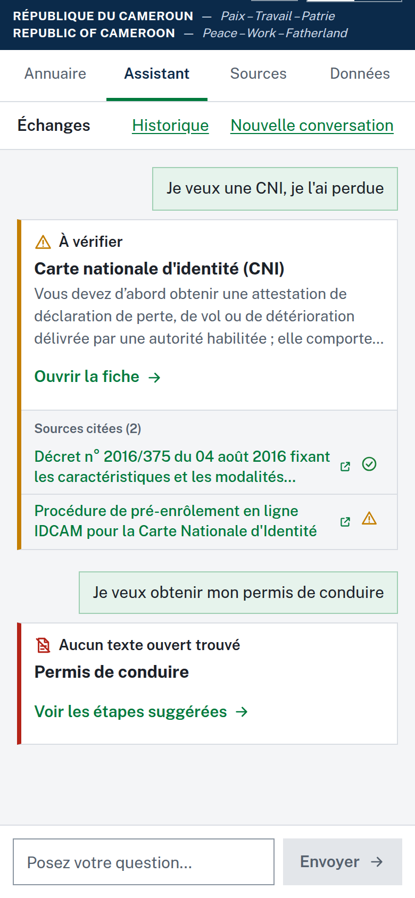<br>Échanges</td>
    <td align="center">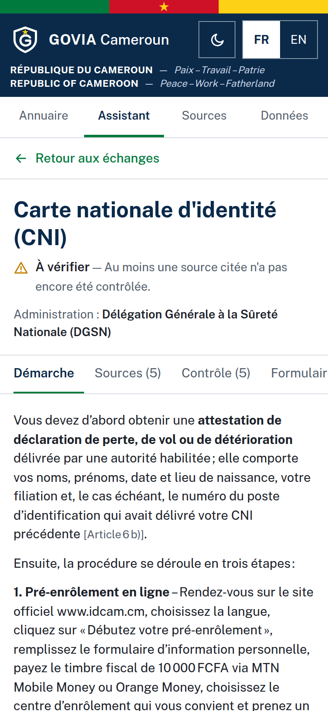<br>Réponse sourcée</td>
  </tr>
  <tr>
    <td align="center">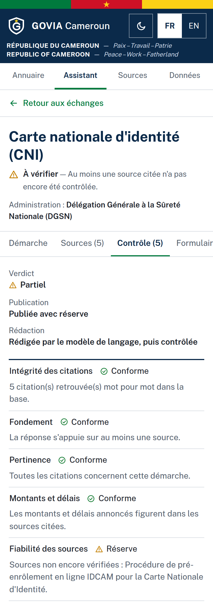<br>Contrôles</td>
    <td align="center">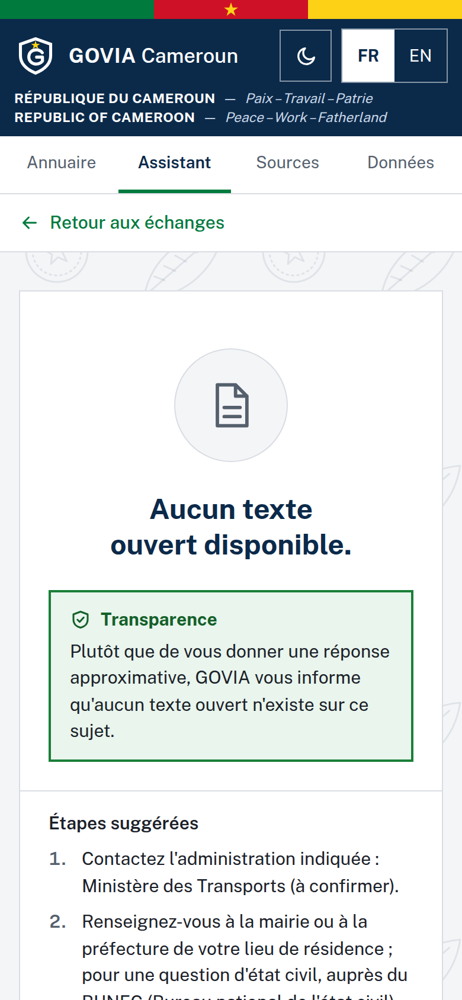<br>Lacune déclarée</td>
    <td align="center">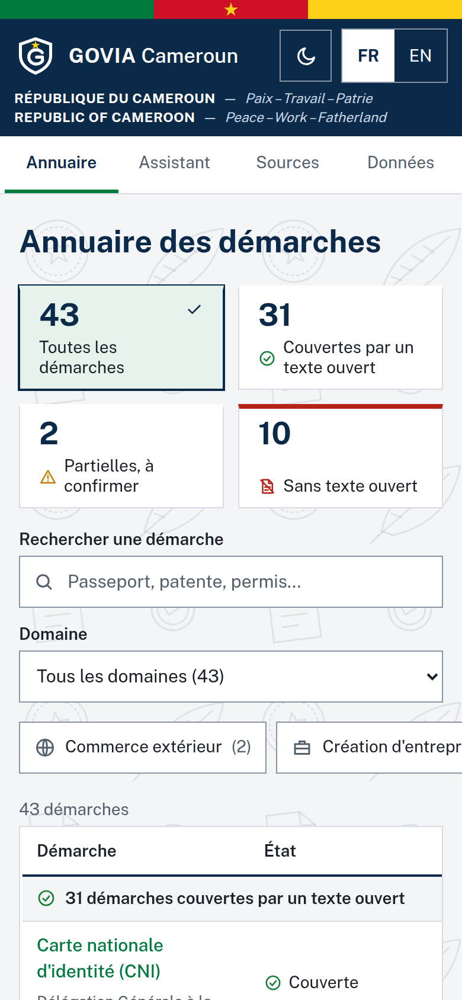<br>Annuaire</td>
  </tr>
</table>

## Principes

| Principe | Mise en œuvre |
|---|---|
| Aucune politique inventée | Chaque pièce ou étape est un extrait exact de sa source ; `scripts/build_kb.py` refuse de construire la base sinon |
| Lacunes assumées | Une démarche sans source ouverte est signalée, sans contenu inventé, et alimente l'analyse d'écarts |
| Contrôle avant publication | L'auditeur vérifie intégrité des citations, pertinence, montants, délais et articles ; un texte du LLM rejeté est remplacé par les extraits sourcés |
| Données | Consentement préalable (art. 9), notice d'information (art. 21), masquage avant le modèle, LLM local par défaut, rien de personnel dans le journal |
| Citoyen décisionnaire | L'agent prépare, le citoyen vérifie et soumet |

Le masquage relève de la pseudonymisation au sens de l'article 5 de la Loi n° 2024/017 : il peut être incomplet, et ce prototype ne doit pas recevoir de vraies pièces.

## Architecture

GOVIA repose sur quatre agents :

| Agent | Rôle | Module |
|---|---|---|
| Orchestrateur | Coordination et gestion du flux de travail : enchaîne les agents, fait rédiger le LLM local, compose la réponse | `agent.py` |
| Analyse | Compréhension de la demande et classification de la procédure : refus, précision demandée, hors périmètre, lacune, démarche et cas | `analyse.py` (s'appuie sur `catalogue.py`) |
| Recherche | Recherche documentaire et extraction des informations pertinentes (RAG) : pièces, étapes, coûts, citations, limitées à la démarche | `recherche.py` (s'appuie sur `rag.py`) |
| Validation | Vérification des informations, conformité et contrôle des sources : sur le brouillon du LLM, puis sur la réponse finale | `auditor.py` |

```
Citoyen ──> Next.js (FR/EN) ──> /api/* ──> FastAPI (main.py)
                                              │
                                        Orchestrateur ─────────────────────────────┐
                                         │ 1. Analyse      démarche, cas, ambiguïté  │
                                         │ 2. Recherche    catalogue + RAG           │
                                         │ 3. Rédaction    LLM local, données masquées
                                         │ 4. Validation   brouillon, puis réponse finale
                                         └──> publier / publier avec réserve / bloquer

Services : rag.py (ChromaDB, ou mots-clés en secours) · privacy.py (masquage avant le modèle)
           ocr.py (lecture d'une pièce) · journal.py (journal d'audit sans donnée personnelle)
```

Chaque entrée de `audit_log` indique l'agent qui l'a produite (`analyse`, `recherche`, `orchestrateur`, `validation`).

## Base de connaissances

| Élément | Valeur |
|---|---|
| Documents | 46 (dont 2 références internationales) |
| Chunks | 264 (256 vérifiés à la source, 8 à vérifier) |
| Démarches | 43 : 31 couvertes, 2 partielles, 10 lacunes |
| Langues | Français ; anglais pour la loi sur la cybersécurité |

- Détail et lacunes : [`docs/catalogue_demarches.md`](docs/catalogue_demarches.md)
- Sources et méthode de vérification de chaque document : [`knowledge_base/index.json`](knowledge_base/index.json)

Chaque chunk indique notamment `article`, `texte`, `source_url`, `type_source` et `statut_verification`.

**Sources :** textes officiels (Présidence, ANTIC, Ministère du Commerce), reproductions de textes par des tiers (signalées comme telles) et 32 fiches du portail [eRegulations Yaoundé](https://yaounde.eregulations.org).

**Références internationales :** le RGPD (UE 2016/679) et le règlement européen sur l'IA (UE 2024/1689), recopiés depuis EUR-Lex, servent à comparer les lacunes camerounaises aux bonnes pratiques. Rangés sous `references_internationales`, hors catalogue, ils ne sont jamais cités au citoyen comme droit applicable.

### Mettre à jour la base

```bash
# 1. Modifier scripts/kb_data/textes.py ou catalogue.py, ou réextraire les fiches :
python scripts/fetch_eregulations.py
# 2. Reconstruire : échoue si un extrait ne figure pas dans sa source
python scripts/build_kb.py
```

Ne modifiez pas `knowledge_base/` à la main : `python scripts/build_kb.py --check` détecte tout écart.

## Démarrage

### Docker

```bash
cp .env.example .env
docker compose up --build
```

- Interface : http://localhost:3000
- API : http://localhost:8000 (documentation sur `/docs`)

Le premier démarrage télécharge le modèle `mistral:7b` (environ 4 Go). Tant qu'il n'est pas prêt, ou si le LLM ne répond pas, GOVIA répond avec les seuls extraits sourcés. Prévoyez 8 Go de RAM au minimum ; sans GPU, une réponse du LLM peut prendre plusieurs minutes.

### Sans Docker

```bash
# Backend
cd backend
python3.11 -m venv .venv && source .venv/bin/activate
pip install -r requirements-dev.txt
LLM_URL=http://localhost:11434/api/generate uvicorn main:app --reload --port 8000

# LLM local
ollama serve
ollama pull mistral:7b

# Frontend
cd frontend
npm ci
API_URL=http://localhost:8000 npm run dev
```

## Tests

```bash
cd backend && pytest
python scripts/build_kb.py --check

# Mêmes tests avec la vraie recherche vectorielle
cd backend && GOVIA_TEST_CHROMA=1 pytest

# Interface : Firefox réel, Next.js standalone et FastAPI, sans LLM ni Chroma.
# Couvre le parcours citoyen (consentement, précision requise, aucun texte ouvert, fiche), l'accessibilité WCAG A/AA (axe-core),
# la taille des cibles (44 px), le mouvement réduit et un écran de 360 px.
pip install selenium
cd frontend && npm run build && cd ..
python scripts/test_interface.py
```

## Comparaison version A / version B

La version A interroge le LLM seul ; la version B applique toute la gouvernance. Les deux utilisent le même modèle.

```bash
# LLM local
LLM_URL=http://localhost:11434/api/generate python scripts/compare_ab.py
# Ou LLM cloud, pour les seules questions fixes et fictives du script (pause pour le quota gratuit)
GOVIA_ALLOW_CLOUD_LLM=1 GROQ_API_KEY=... COMPARE_PAUSE=45 python scripts/compare_ab.py
```

Le résultat est écrit dans `docs/comparaison_ab.md`. Sans LLM joignable, la version A est marquée « non exécutée » : aucune réponse n'est simulée. Lors de l'exécution du 10 novembre 2026 (gpt-oss-120b), l'auditeur a jugé non conformes les 11 réponses de la version A.

## API

| Endpoint | Méthode | Rôle |
|---|---|---|
| `/` | GET | État du service |
| `/consentement?langue=FR` | GET | Notice d'information |
| `/kb/stats`, `/kb/documents`, `/kb/catalogue` | GET | Base, sources, démarches et lacunes |
| `/kb/search?q=...&n=5` | GET | Recherche dans la base |
| `/chat` | POST | Orchestrateur et ses trois agents |
| `/upload` | POST | Lecture d'une pièce pour préparer le formulaire |

```json
POST /chat
{
  "messages": [{"role": "user", "content": "Je veux renouveler ma CNI, je l'ai perdue"}],
  "consentement": true,
  "language": "FR"
}
```

## Configuration

Voir [`.env.example`](.env.example). Le seuil de recherche `GOVIA_MIN_SCORE` vaut 0,45 : sa mesure est dans [`docs/calibration_seuil.md`](docs/calibration_seuil.md) et se refait avec `scripts/calibrer_seuil.py`. Le LLM cloud reste désactivé sauf `GOVIA_ALLOW_CLOUD_LLM=1` : il implique un transfert à l'étranger soumis à autorisation préalable (art. 32).

## Limites connues

- Le backend ne se connecte à rien d'extérieur d'après un échantillonnage de ses connexions (`onnxruntime` contactait Microsoft avant `ORT_DISABLE_TELEMETRY=1`). Une mise en production doit en plus bloquer le trafic sortant au niveau du réseau.
- La notice annonce le droit de contester une réponse et de demander une intervention humaine (art. 21 et 44), mais aucun contact n'est encore indiqué : l'équipe doit compléter `NOTICE` dans `backend/main.py`.
- 8 chunks IDCAM et PassCam restent à contrôler dans un navigateur.
- La loi n° 2011/011 sur l'état civil n'a pas pu être consultée : les délais cités proviennent de l'ordonnance de 1981 et sont signalés comme à confirmer.
- Les fiches eRegulations ne sont pas datées et concernent Yaoundé ; les montants et délais sont à confirmer au guichet.
- L'auditeur ne contrôle pas les nombres écrits en toutes lettres ni le sens général d'un texte du LLM.
- Les étapes, les pièces et le détail des contrôles restent en français, y compris dans une réponse en anglais.
- Les quatre agents partagent un même mandat : pas encore de coordination entre agents institutionnels (régulateur, autorité de protection des données) recevant des informations différentes, et les scénarios d'erreur sont scriptés plutôt que libérés par fragments.
- Il n'existe pas d'API publique IDCAM ou PassCam : le formulaire aide à préparer la saisie, rien n'est soumis.

## Licence des contenus

Les textes réglementaires et les fiches appartiennent à leurs auteurs ; `source_url` indique leur origine. Les informations de GOVIA ne remplacent ni le texte officiel ni l'administration compétente.
