# GOVIA Cameroon

*[Version française](README.fr.md)*

A bilingual (French/English) agentic assistant for public administrative procedures in Cameroon, with built-in compliance checks. Built for the ITU AI for Good Sandbox Hackathon (United Arab Emirates).

GOVIA covers identity documents and civil status, as well as company creation, taxes, social protection, urban planning, land, foreign trade, vehicles and associations. It cites its sources, asks for clarification rather than guessing, and says plainly when no open text exists.

## For the jury

| What | Where |
|---|---|
| Technical report (5 pages): Y.3172 mapping, AI Readiness dimensions, error scenarios, gap analysis | [`docs/rapport/GOVIA_Cameroun_Rapport_Technique.docx`](docs/rapport/GOVIA_Cameroun_Rapport_Technique.docx) |
| Open knowledge base: 264 machine-readable chunks from 46 documents | [`knowledge_base/`](knowledge_base/), inventory in [`knowledge_base/index.json`](knowledge_base/index.json) |
| Procedure coverage and documented gaps (43 procedures) | [`docs/catalogue_demarches.md`](docs/catalogue_demarches.md) |
| Version A (LLM alone) vs version B (governed), same model, same questions | [`docs/comparaison_ab.md`](docs/comparaison_ab.md), full answers in [`docs/comparaison_ab.json`](docs/comparaison_ab.json) |
| Audit log format (no personal data) | [`backend/journal.py`](backend/journal.py) |

## Screenshots

The interface is shown in English; an FR/EN switch sits in the header. Source titles stay in their original French.

**Procedure directory**: 43 procedures, each marked as covered by an open text, partial, or without open text.

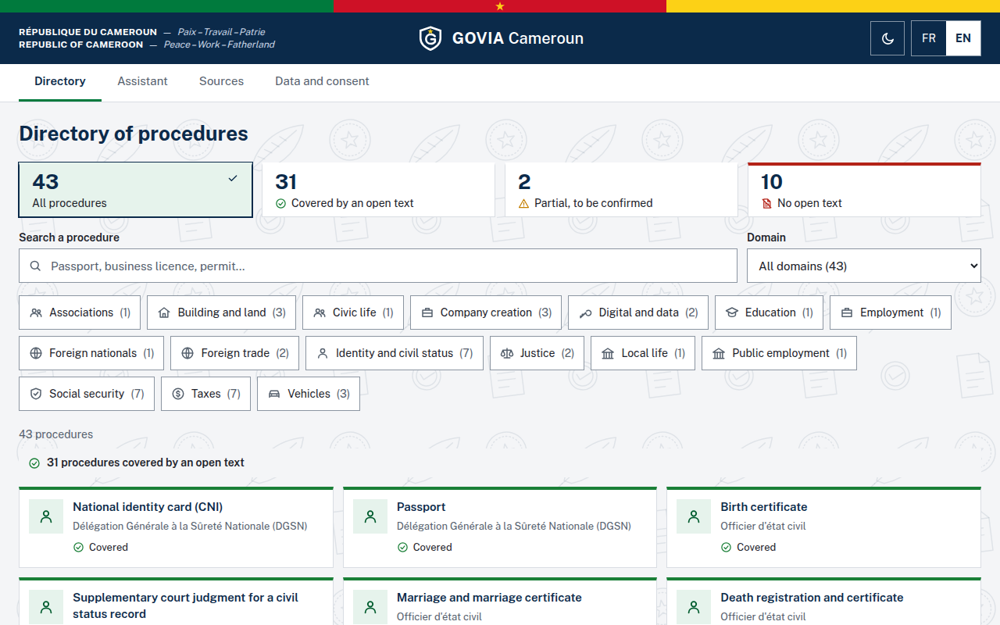

**Clarification required**: "I want to renew my card" could mean three procedures. GOVIA asks instead of guessing, and explains why.

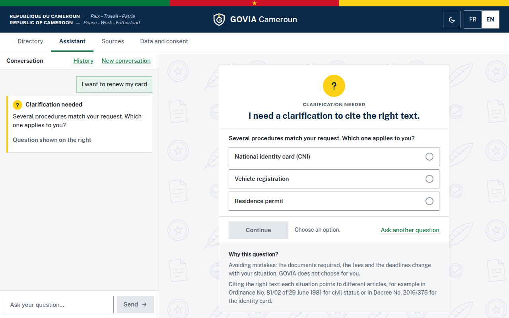

**Sourced answer**: lost national ID card. Each statement points to its article or step, and the record warns that one source is still "to verify".

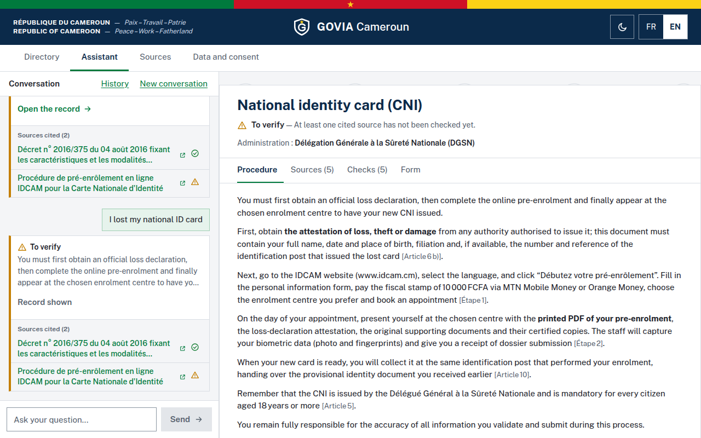

**Audit checks**: the validation agent's verdict, publication decision and the result of each check, visible to the citizen.

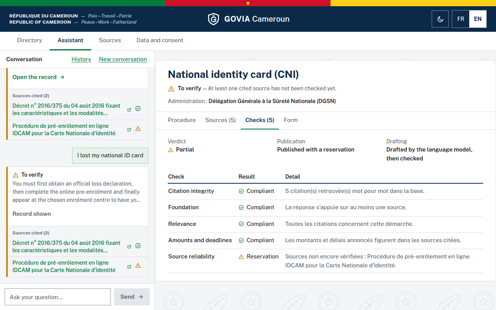

**Documented gap**: no open text governs the driving licence, so GOVIA says so and gives no invented steps.

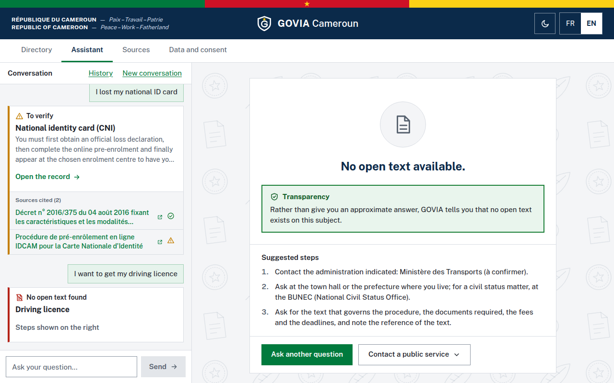

### On a phone

On a phone, an answer opens full screen with a "Back to the conversation" link, and the audit checks stack vertically.

<table>
  <tr>
    <td align="center">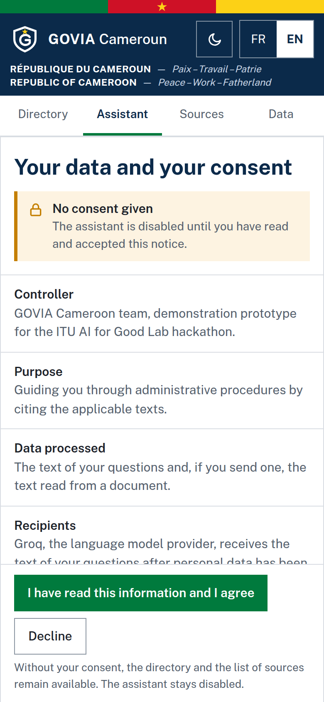<br>Consent first</td>
    <td align="center">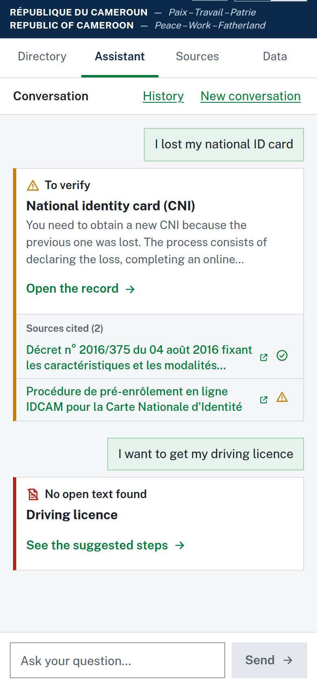<br>Conversation</td>
    <td align="center">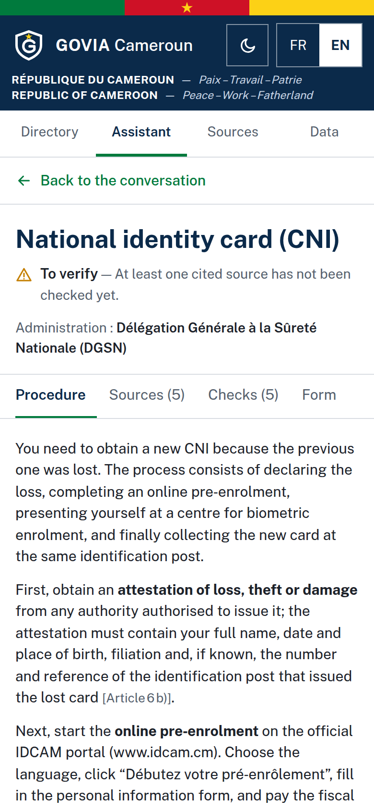<br>Sourced answer</td>
  </tr>
  <tr>
    <td align="center">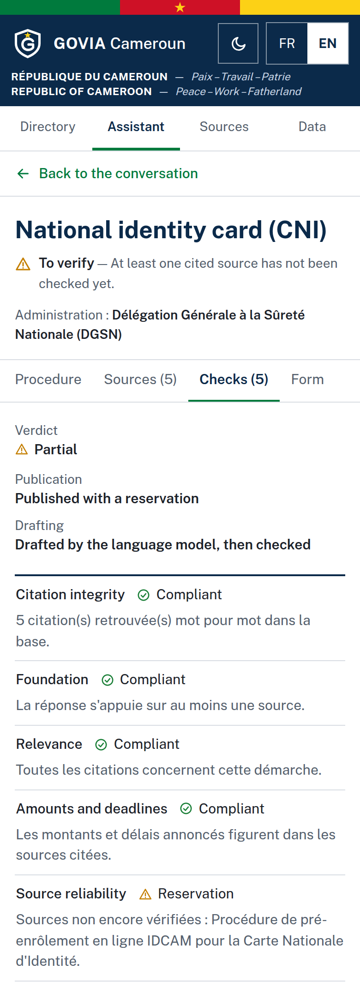<br>Audit checks</td>
    <td align="center">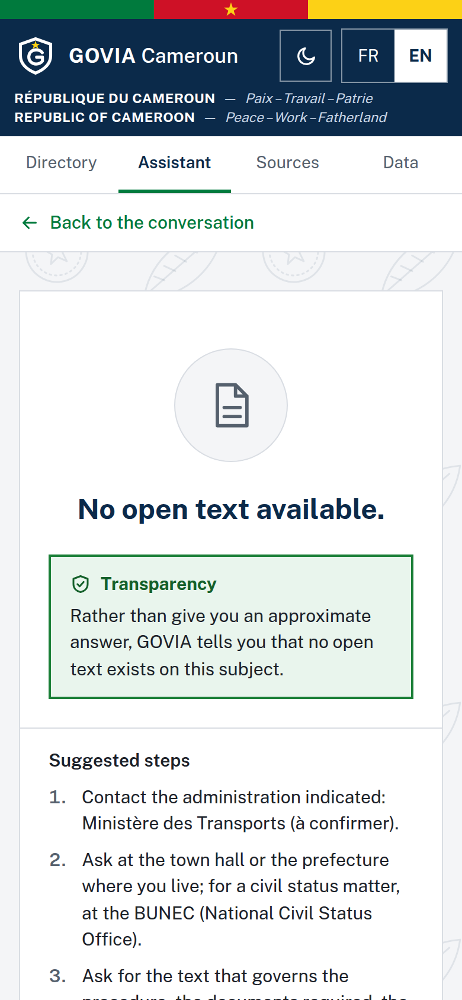<br>Documented gap</td>
    <td align="center">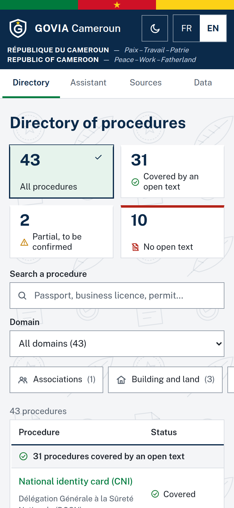<br>Directory</td>
  </tr>
</table>

## Principles

| Principle | Implementation |
|---|---|
| No invented policy | Every listed document or step is an exact extract of its source; `scripts/build_kb.py` refuses to build the base otherwise |
| Gaps are declared | A procedure with no open source is flagged, with no invented content, and feeds the gap analysis |
| Checked before publication | The auditor checks citation integrity, relevance, amounts, deadlines and article numbers; a rejected LLM draft is replaced by the sourced extracts |
| Data protection | Prior consent (art. 9), information notice (art. 21), masking before the model, local LLM by default, nothing personal in the log |
| The citizen decides | The agent prepares; the citizen checks and submits |

Masking is pseudonymisation within the meaning of article 5 of Law No. 2024/017: it may be incomplete, and this prototype must not receive real identity documents.

## Architecture

GOVIA relies on four agents:

| Agent | Role | Module |
|---|---|---|
| Orchestrator | Coordinates the workflow: chains the agents, has the LLM draft, composes the answer | `agent.py` |
| Analysis | Understands the request and classifies it: refusal, clarification, out of scope, gap, procedure and case | `analyse.py` (uses `catalogue.py`) |
| Research | Retrieves documents and extracts the relevant information (RAG): documents, steps, fees, citations, limited to the procedure | `recherche.py` (uses `rag.py`) |
| Validation | Checks facts, compliance and sources: on the LLM draft, then on the final answer | `auditor.py` |

```
Citizen ──> Next.js (FR/EN) ──> /api/* ──> FastAPI (main.py)
                                              │
                                        Orchestrator ──────────────────────────────┐
                                         │ 1. Analysis     procedure, case, ambiguity
                                         │ 2. Research     catalogue + RAG           │
                                         │ 3. Drafting     local LLM, masked data    │
                                         │ 4. Validation   draft, then final answer  │
                                         └──> publish / publish with reservation / block

Services: rag.py (ChromaDB, keyword fallback) · privacy.py (masking before the model)
          ocr.py (reading a document) · journal.py (audit log without personal data)
```

Each `audit_log` entry names the agent that produced it (`analyse`, `recherche`, `orchestrateur`, `validation`).

## Knowledge base

| Item | Value |
|---|---|
| Documents | 46 (including 2 international references) |
| Chunks | 264 (256 checked against their source, 8 to verify) |
| Procedures | 43: 31 covered, 2 partial, 10 gaps |
| Languages | French; English for the cybersecurity law |

Each chunk records, among other fields, `article`, `texte`, `source_url`, `type_source` and `statut_verification`.

**Sources:** official texts (Presidency, ANTIC, Ministry of Trade), third-party reproductions of texts (flagged as such) and 32 records from the [eRegulations Yaoundé](https://yaounde.eregulations.org) portal.

**International references:** the GDPR (EU 2016/679) and the EU AI Act (EU 2024/1689), copied from EUR-Lex, serve to compare Cameroonian gaps with global practice. Stored under `references_internationales`, outside the citizen catalogue, they are never cited to a citizen as applicable law (a test enforces this).

### Updating the base

```bash
# 1. Edit scripts/kb_data/textes.py or catalogue.py, or re-extract the portal records:
python scripts/fetch_eregulations.py
# 2. Rebuild: fails if an extract is not found in its source
python scripts/build_kb.py
```

Do not edit `knowledge_base/` by hand: `python scripts/build_kb.py --check` detects any drift.

## Getting started

### Docker

```bash
cp .env.example .env
docker compose up --build
```

- Interface: http://localhost:3000
- API: http://localhost:8000 (documentation at `/docs`)

The first start downloads the `mistral:7b` model (about 4 GB). Until it is ready, or if the LLM does not respond, GOVIA answers with the sourced extracts only. Allow at least 8 GB of RAM; without a GPU, an LLM answer can take several minutes.

### Without Docker

```bash
# Backend
cd backend
python3.11 -m venv .venv && source .venv/bin/activate
pip install -r requirements-dev.txt
LLM_URL=http://localhost:11434/api/generate uvicorn main:app --reload --port 8000

# Local LLM
ollama serve
ollama pull mistral:7b

# Frontend
cd frontend
npm ci
API_URL=http://localhost:8000 npm run dev
```

## Tests

```bash
cd backend && pytest
python scripts/build_kb.py --check

# Same tests with real vector search
cd backend && GOVIA_TEST_CHROMA=1 pytest

# Interface: real Firefox, standalone Next.js and FastAPI, without LLM or Chroma.
# Covers the citizen journey (consent, clarification, no open text, record), WCAG A/AA accessibility (axe-core),
# target size (44 px), reduced motion and a 360 px screen.
pip install selenium
cd frontend && npm run build && cd ..
python scripts/test_interface.py
```

## Version A / version B comparison

Version A queries the LLM alone; version B applies the full governance. Both use the same model.

```bash
# Local LLM
LLM_URL=http://localhost:11434/api/generate python scripts/compare_ab.py
# Or a cloud LLM, with the script's fixed, fictitious questions only (pause for the free-tier quota)
GOVIA_ALLOW_CLOUD_LLM=1 GROQ_API_KEY=... COMPARE_PAUSE=45 python scripts/compare_ab.py
```

Results go to `docs/comparaison_ab.md`. Without a reachable LLM, version A is marked "not run": no answer is simulated. In the run of 10 November 2026 (gpt-oss-120b), the auditor rated all 11 version A answers non-compliant. Version A cited a French administrative form for a Cameroonian ID card, invented office addresses, gave a full driving-licence procedure with no open source, and named the cybersecurity law as the data protection law.

## API

| Endpoint | Method | Role |
|---|---|---|
| `/` | GET | Service status |
| `/consentement?langue=FR` | GET | Information notice |
| `/kb/stats`, `/kb/documents`, `/kb/catalogue` | GET | Base, sources, procedures and gaps |
| `/kb/search?q=...&n=5` | GET | Search the base |
| `/chat` | POST | Orchestrator and its three agents |
| `/upload` | POST | Read a document to prepare the form |

```json
POST /chat
{
  "messages": [{"role": "user", "content": "I want to renew my ID card, I lost it"}],
  "consentement": true,
  "language": "EN"
}
```

## Configuration

See [`.env.example`](.env.example). The retrieval threshold `GOVIA_MIN_SCORE` is 0.45; its measurement is in [`docs/calibration_seuil.md`](docs/calibration_seuil.md) and can be repeated with `scripts/calibrer_seuil.py`. The cloud LLM stays off unless `GOVIA_ALLOW_CLOUD_LLM=1`: it implies a transfer abroad that requires prior authorisation (art. 32).

## Known limitations

- Based on sampling its connections, the backend contacts nothing outside (`onnxruntime` contacted Microsoft until `ORT_DISABLE_TELEMETRY=1`). A production deployment must also block outbound traffic at network level.
- The notice announces the right to contest an answer and to request human intervention (arts. 21 and 44), but no contact is given yet: the team must complete `NOTICE` in `backend/main.py`.
- 8 IDCAM and PassCam chunks still need checking in a browser.
- Law No. 2011/011 on civil status could not be consulted: the deadlines quoted come from the 1981 ordinance and are flagged as to be confirmed.
- eRegulations records are undated and concern Yaoundé; amounts and deadlines must be confirmed at the counter.
- The auditor does not check numbers written in words or the overall meaning of an LLM text.
- Steps, documents and check details stay in French, even in an English answer.
- The four agents share one mandate: there is no coordination yet between institutional agents (regulator, data protection authority) holding different information, and error scenarios are scripted rather than released as fragmented live events.
- IDCAM and PassCam offer no public API: the form helps prepare the entry, nothing is submitted.
- The video in `demo/` shows an earlier version of the interface; the screenshots above are current.

## Content licence

Regulatory texts and portal records belong to their authors; `source_url` gives their origin. GOVIA's information replaces neither the official text nor the competent administration.
